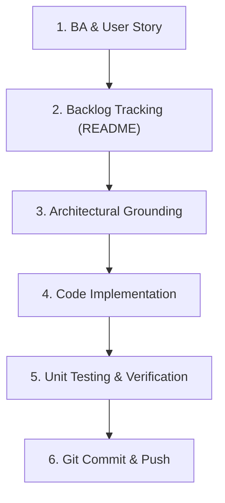

# Implement Feature (`implement-feature`)

Use this skill when delivering a new feature or functional enhancement end-to-end. It enforces a professional Agile/Scrum workflow: transitioning from stakeholder intent to a formal User Story, grounding in the existing architecture, implementing the code and tests, and delivering via version control.

---

## End-to-End Delivery Lifecycle



---

## Step 1: Business Analysis & User Story Authoring

Before writing code, formalize the feature requirement according to EPAM Business Analysis standards:

1. **User Persona & Value Proposition**:
   - Identify the primary actor (`Customer (Reservation Owner)`, `Guest (Visitor, unregistered)`, `Waiter`, `Admin`).
   - Define the goal and tangible benefit: `As a <Role>, I want <Goal>, so that <Benefit>.`

2. **File Location & Numbering**:
   - Create a Markdown file in `user-stories/US{ID}-{feature-name}.md`.
   - Number sequentially starting from `US1` (e.g., `US1-sort-reservations.md`, `US2-...`).

3. **User Story Structure**:
   ```markdown
   # US{ID}_{Story Name}

   | Field | Value |
   | --- | --- |
   | **Epic** | <Epic Name> |
   | **US name** | <Story Name> |
   | **Role** | <User Persona / Role> |
   | **Description** | As a <Role>, I want <Goal>, so that <Benefit>. |

   ### Pre-conditions:
   - <Pre-condition 1: Authentication / context>
   - <Pre-condition 2: Screen / data readiness>

   ### Acceptance Criteria (AC):
   1. <UI placement and visibility>
   2. <Functional options and behavior>
   3. <Default state / selection>
   4. <Immediate interaction feedback (no full page reload)>
   5. <Edge cases / empty states / negative paths>
   6. <Accessibility & responsiveness>

   ### Assumptions & Open Questions (Optional):
   - **Assumptions**: <Business / product assumptions only>
   - **Open Questions**: <UX / scope questions for stakeholders>
   ```

4. **Strict Content Guardrails**:
   - ❌ **No Technical Implementation Details**: Never mention code, framework mechanics (`signals`, `computed`, `RxJS`), database tables, or HTTP methods in the story.
   - ❌ **No Embedded INVEST Checklists**: INVEST is an internal quality guideline for authoring, not a section to paste into user story deliverables.
   - ❌ **No Draft Markers**: Never include `[Draft]` in headers or titles.
   - ❌ **No Technical State/Dependency Tables**: Keep the document readable and accessible to product owners and business stakeholders.

---

## Step 2: Backlog & Documentation Tracking

Immediately register the user story in the project documentation:
- Open `README.md`.
- Under the **📋 Користувацькі історії (Scrum User Stories)** table, add a new row linking to the markdown file with description, epic, and status:
  ```markdown
  | [**`US{ID}-{feature-name}.md`**](user-stories/US{ID}-{feature-name}.md) | **{Feature Name}**: {Brief description} | {Epic} | ⏳ В процесі / ✅ Готово |
  ```

---

## Step 3: Architectural Grounding & Design Consistency

Inspect the codebase before writing code to ensure 100% architectural and visual consistency:

1. **Examine Existing Patterns**:
   - Locate related components, services, models, and routes (e.g. `frontend/restaurant-frontend-app/src/app/`).
   - Inspect existing controls (dropdowns, buttons, modals) and reuse shared SCSS tokens (`colors`, `typography`, `/assets/svg/` icons).
2. **State Management & Data Flow**:
   - Use reactive Angular signals (`signal`, `computed`) for local state.
   - Derive UI state reactively so user actions (sorting, filtering) update instantaneously in-memory without unnecessary HTTP roundtrips or screen flicker.
3. **Backend / API Check**:
   - Determine if existing endpoints suffice or if backend Lambda / DynamoDB DTO changes are required.

---

## Step 4: Code Implementation

Apply clean, modular changes across the relevant layers:

1. **Models / Types**:
   - Define type-safe enums or union types (e.g., `ReservationSortOption`).
2. **Component Logic**:
   - Introduce signals for active selection (`selectedSort = signal(...)`).
   - Implement computed derivations (`sortedItems = computed(...)`) with deterministic tie-breaking logic.
   - Handle events (`onSortChanged(event: Event)`).
3. **HTML Template**:
   - Bind controls with semantic, accessible markup (`aria-label`, associated `<label for="...">`).
   - Guard controls when data is loading or empty (`@if (items().length > 0)`).
   - Iterate over computed collections (`@for (item of sortedItems(); track item.id)`).
4. **SCSS Styling**:
   - Adhere to design system tokens.
   - Ensure responsive layouts (`flex-wrap: wrap`, mobile media queries down to 375px).

---

## Step 5: Automated Verification & Unit Testing

Never deliver unverified code. Execute all automated verification gates:

1. **Type Checking**:
   ```bash
   cd frontend/restaurant-frontend-app
   npx tsc -p tsconfig.app.json --noEmit
   npx tsc -p tsconfig.spec.json --noEmit
   ```

2. **Unit Tests**:
   - Create or update the `.spec.ts` file to test each Acceptance Criterion:
     - Default state / ordering.
     - Each sort option or filter variation.
     - Event handling.
     - Tie-breaking and edge cases.
   ```bash
   npx ng test --watch=false --include src/app/path/to/component.spec.ts
   ```

3. **Regression & Build Check**:
   ```bash
   npm run test:hw
   BACKEND_URL=https://example.com npm run build
   ```

---

## Step 6: Git Commit & Delivery

1. Review changed files:
   ```bash
   git status
   git diff
   ```
2. Stage all deliverables (User Story, README, code, tests, agent/skill updates):
   ```bash
   git add user-stories/ README.md frontend/ .ai/
   ```
3. Commit with Conventional Commits message:
   ```bash
   git commit -m "feat(<scope>): <concise description of feature and story>"
   ```
4. Push to remote:
   ```bash
   git push origin main
   ```
